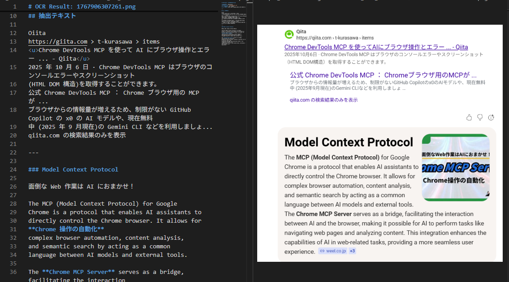

# Agent Skills

A collection of Agent Skills for GitHub Copilot and Claude.

GitHub Copilot と Claude 向けの Agent Skills コレクションです。

## Demo

### OCR Super Surya



### draw.io Diagram Forge


## Skills

<!-- public-skills-table:start -->
| Skill | Description / 説明 |
| --- | --- |
| [agentic-workflow-guide](agentic-workflow-guide/) | Design, review, and debug agent workflows, and decide when a request should use a prompt, instruction, skill, agent, or hook before escalating to multi-agent design. Use for .ag... |
| [ai-cli-benchmark](ai-cli-benchmark/) | Design, run, and review fair performance, token, and cost comparisons across GitHub Copilot CLI, Codex CLI, and direct model APIs. Use for AI CLI benchmark, Copilot vs Codex, pr... |
| [analyze-copilot-sessions](analyze-copilot-sessions/) | Analyze historical VS Code GitHub Copilot Chat sessions by model, reasoning effort, AIU, time, reliability, workflow behavior, and external quality evidence, or safely prune wor... |
| [animated-infographic](animated-infographic/) | Create reproducible animated infographic GIFs from structured data or measured results, with audience-language labels, explicit timing semantics, representative-frame QA, and a... |
| [archify](archify/) | Create polished, validated architecture, workflow, sequence, data-flow, and lifecycle/state diagrams as explorable standalone HTML with inline SVG, dark/light themes, optional t... |
| [ascii-banner](ascii-banner/) | Generate ASCII-art text banners for terminals, READMEs, and CLI startup messages |
| [azure-advisor-report](azure-advisor-report/) | Generate Azure environment monthly report (Markdown + PowerPoint) from Azure Advisor and Cost Management API |
| [azure-env-builder](azure-env-builder/) | [Alpha] Experimental Azure environment builder for infrastructure and deployment design |
| [azure-infra-validation](azure-infra-validation/) | Build and validate Azure infrastructure in a lab or sandbox using Azure CLI and official Microsoft docs |
| [azure-screenshot-mask](azure-screenshot-mask/) | Mosaic environment-sensitive areas (tenant name, user avatar, subscription name / ID, resource group, internal hostnames) on Azure Portal screenshots before publishing to blogs,... |
| [azure-troubleshooting](azure-troubleshooting/) | Investigate Azure incidents and service degradations with a read-only workflow using Azure CLI, Resource Health, Activity Log, metrics, resource logs, and official Microsoft docs |
| [azure-update-customer-pptx](azure-update-customer-pptx/) | Build a customer-facing Azure Update PowerPoint from Azure Updates MCP results, including customer classification, Japan region stamps, UPDATE Points, speaker notes, and Verify-... |
| [biz-ops-setup](biz-ops-setup/) | Set up or operate a business operations workspace for activity reports, tasks, and customer routing; workIQ is optional |
| [book-writing-workspace](book-writing-workspace/) | Operate a reusable technical book manuscript workspace with writing structure, reader persona SSOT, review rules, and optional Markdown to Re:VIEW/PDF support |
| [browser-bookmark-organizer](browser-bookmark-organizer/) | Safely audit, classify, deduplicate, and reorganize Chrome or Edge browser bookmarks/favorites while preserving toolbar shortcuts, active profiles, and observable sync state. Us... |
| [browser-max-automation](browser-max-automation/) | Visible browser automation using available Playwright, CLI, CDP, or computer-use tools with scoped actions and durable verification. Use for navigation, forms, screenshots, down... |
| [check-github-activity](check-github-activity/) | 現在または指定したGitHubリポジトリの新しいIssue、Pull Request、コメント、レビュー指摘をread-onlyで確認し、対応要否ごとに要約する。Use when: 新着Issue確認、新しいPR確認、コメント確認、レビュー返信確認、GitHub更新確認。 |
| [chrome-extension-dev](chrome-extension-dev/) | Chrome/ブラウザ拡張機能開発の包括的ガイド。WXTフレームワーク、Manifest V3、Chrome API、テスト手法、ストア公開（CWS API v2 での提出自動化を含む）をカバー。Use when: ブラウザ拡張機能を作成・修正・公開する時。Triggers on 'ブラウザ拡張機能', 'Chrome拡張', 'browser ext... |
| [code-review-multi-angle](code-review-multi-angle/) | 差分、PR、選択範囲、指定ファイルを多角的にレビューし、既定は read-only、明示指示があれば critic review 後に修正と検証まで行う。日常コードレビューの入口で、`fix` 指定で Fix now / Guard now / Block に分けて最小修正・同根 Sweep・検証まで閉じる |
| [code-review-security](code-review-security/) | 差分、PR、選択範囲、指定ファイルをセキュリティ観点で read-only レビューし、rubber duck / critic review で確認してから高信頼の脆弱性を報告する |
| [code-simplifier](code-simplifier/) | Guide for simplifying and refining code after coding sessions |
| [context-to-video](context-to-video/) | Turn any context (blog URL, pasted article, PR diff, meeting notes, release notes, raw prompt) into a narrated explainer mp4 with slides, subtitles, and optionally a talking-hea... |
| [create-test-request](create-test-request/) | Use when: 会話・設計資料・回答文書から検証タスクを抽出し、別workspaceへ渡すテスト依頼文を作成する。受け手は最初に理解内容と実施項目を返し、承認後に検証する |
| [customer-workspace](customer-workspace/) | Set up and operate customer workspaces: route customer updates, record meetings, track questions and actions, manage workstreams, and prepare handoffs |
| [document-knowledge-ingestion](document-knowledge-ingestion/) | Read multiple local documents deeply and preserve a source-linked Markdown knowledge library. Use for consolidating notes, books, PDFs, presentations, and screenshots across fol... |
| [drawio-diagram-forge](drawio-diagram-forge/) | Generate draw.io editable diagrams (.drawio, .drawio.svg) from text, images, or Excel. Orchestrates 3-agent workflow (Analysis → Manifest → SVG generation) with quality gates |
| [duck-critic](duck-critic/) | Run a Duck Critic producer-critic loop: you (main) keep producing the plan/code/tests and gate your own work at checkpoints with a different-model critic, revising until it passes |
| [evaluate-waza-copilot-customizations](evaluate-waza-copilot-customizations/) | Waza で個人（~/.copilot）/ ワークスペース / 任意パスの instructions / agents / skills をセットアップ、static/runtime 評価、gate 単体実行、結果要約、report 更新まで行う。 |
| [explain-release-changes](explain-release-changes/) | 前回リリース以降の変更を、コードを知らない人にも伝わる説明文にする。Use when: リリースノートを一般向けに書き直したい、今回の変更を人に説明したい、ブログ/SNS/社内共有向けに変更点を紹介したい、機能の移植元（姉妹repo・参考OSS等）を明記して伝えたい |
| [export-copilot-session-dialogue](export-copilot-session-dialogue/) | Interaction flow: セッション中の対話フロー・使用ツール・手順を構造化して出力。Use when: dialogue, tool flow, handoff, 手順再現。作業ログは export-session-log、再利用知見は export-knowledge を使う |
| [export-knowledge](export-knowledge/) | Reusable learnings: セッション中の再利用知見を構造化し、ドメイン別（microsoft / copilot など）に振り分けて出力。Use when: knowledge, lessons learned, 知見化。作業ログは export-session-log、対話再現は export-copilot-session-dialo... |
| [export-session-log](export-session-log/) | Export the current chat session as a structured Markdown work timeline or blog-draft seed |
| [fact-check](fact-check/) | ファイル、選択範囲、貼り付けた本文、URL 一覧に含まれる主張・数値・引用・参照先を 3 フェーズで検証する汎用ファクトチェック。 |
| [generate-news-x-posts](generate-news-x-posts/) | Use when: 当日ニュース、ニュースURL、時事テーマから、事実確認済みのX投稿候補を複数作る。短い日常文や下書きのリライトは rewrite-x-post を使う |
| [git-commit](git-commit/) | ディスク上の変更を作業単位でコミット（Pushなし） |
| [git-commit-push](git-commit-push/) | ディスク上の変更を作業単位でコミット＆プッシュ |
| [git-pull](git-pull/) | リモートからPullして変更箇所を表示 |
| [goal-loop](goal-loop/) | Run an explicit end-to-end goal loop with frozen Scope/criteria, worker delegation, external verification, evaluator review, and bounded retries |
| [html-pdf-slides](html-pdf-slides/) | Make good-looking slide-style PDFs fast with HTML + headless Chrome instead of PowerPoint: a ready 1280x720 template (Microsoft-style cover / content slide / ending), a render s... |
| [humanize-writing](humanize-writing/) | Remove AI-generated tone and make writing sound more human in Japanese and English |
| [integrate-external-knowledge](integrate-external-knowledge/) | Use when: 他案件、会議メモ、チャット、資料、URLから再利用可能な知見を抽出し、指定フォーカスまたは現在のworkspace目的に合わせて既存ナレッジへ整理・統合する |
| [local-media-transcription](local-media-transcription/) | Transcribe local MP4/M4A/MP3/WAV/WEBM audio or video with ffmpeg and Whisper, then optionally produce diarized transcripts, customer-facing meeting minutes, action items, and PP... |
| [microsoft-forms-builder](microsoft-forms-builder/) | Create and configure Microsoft Forms surveys through an owned browser session (Playwright over CDP): title, description, text/choice questions, free-text 'Other', required flags... |
| [microsoft-graph-gateway](microsoft-graph-gateway/) | Route Microsoft Graph work from VS Code |
| [ocr-super-surya](ocr-super-surya/) | GPU-optimized OCR using Surya |
| [opportunity-factory](opportunity-factory/) | Run a reusable opportunity-to-artifact workflow: discover unmet needs, set up workspace factories, schedule recurring commander/worker/reporter prompts, batch-refine many items,... |
| [packet-capture-analysis](packet-capture-analysis/) | Use when analyzing pcap or pcapng files, triaging network captures, labeling IPs with evidence, generating PNG charts, or writing packet analysis reports. Keywords: pcap, pcapng... |
| [peer-feedback](peer-feedback/) | 同僚への半期ピアフィードバック下書きを自動生成する。workIQ で 1:1 チャット・グループチャット・メンション・共通会議・メール・SPO の履歴を収集し、6項目テンプレートに沿ってポジティブかつプロモーション志向で起票する。Use when: ピアフィードバック, フィードバック下書き, 同僚評価, 半期フィードバック, 360度フィードバック。 |
| [permission-max](permission-max/) | Reduce repeated permission prompts across Microsoft Scout, Copilot CLI, and host tool confirmations with user-approved settings and explicit before/after verification |
| [power-automate-ops](power-automate-ops/) | Operate and verify Microsoft Power Automate cloud flows in the browser, and migrate them between environments |
| [powerpoint-automation](powerpoint-automation/) | Convert web articles or blog posts into slides through a content.json pipeline, translate or rebuild existing PPTX files onto a template, and edit an already-open PowerPoint dec... |
| [powerpoint-planning](powerpoint-planning/) | Plan high-quality PowerPoint presentations before file creation or editing |
| [project-workspace](project-workspace/) | Create and manage topic-specific project workspaces for validation, investigation, PoC, comparison, or workstreams, including meeting notes in an existing project. Use for a pro... |
| [prompt-to-skill-reconcile](prompt-to-skill-reconcile/) | Prompt ファイル (.prompt.md) から Skill へ移行した後に、ワークスペース内の instructions / agents / README / Skill 本文 / スクリプトに残る旧 Prompt 前提の参照と運用手順を点検し、承認後に最小修正する。Use when: Prompt から Skill に移行した、migrat... |
| [receipt-expense-workflow](receipt-expense-workflow/) | Company expense receipt workflow. OCR, rename, sort, summarize, and prepare receipt images/PDFs/videos for D365 expense mapping and attachment |
| [receipt-tax-ocr](receipt-tax-ocr/) | Organize receipt images and subscription invoice/receipt PDFs for Japanese sole-proprietor or side-business bookkeeping: extract evidence, rename files, and update monthly memos... |
| [record-work-notes](record-work-notes/) | Use when: 作業メモ、事象別ログ、調査・相談・確認・実装・トラブル対応の経緯を残す。会話と作業結果を既存記録へ整理し、継続案件・時系列・出典・残事項を追える形で保存する |
| [refactor-context](refactor-context/) | 指定スコープの instruction / agent / skill をコンテキスト最適化する。単一ファイルも複数ファイル群の MECE 横断レビューも扱う。構造レビューは review-workflow-structure の担当 |
| [refine-product-100](refine-product-100/) | プロダクトを反復実行で最高品質へ近づける。前回サマリーを読み、重複観点を避けて自律的に改善軸を選び、各回で具体改善・検証・記録まで行う。明示 release mode では品質 gate 後に配布と公開状態確認まで進める |
| [report-poc-to-requester](report-poc-to-requester/) | Use when the user asks to turn a finished or paused PoC / validation into a report for the requester: 依頼主向けレポート, 検証結果のご報告, 依頼元への返信, コピペできる報告文, summary-for-requester, 試したこと・結果・サマ... |
| [repurpose-deck-from-reference](repurpose-deck-from-reference/) | Build a new-topic PPTX by reusing an existing reference deck's template (layouts / footers / fonts / palette) while replacing all content from primary sources |
| [retro-private-skills](retro-private-skills/) | Reflect reusable learnings into a private Agent Skills repository with scoped safety gates and same-run private commit/push. Not for editing ~/.copilot personal assets or worksp... |
| [retro-user](retro-user/) | Reflect verified incident or session learnings into personal Copilot or Codex instructions and configuration. Invoke explicitly for Retro User, user-wide retrospective, 個人設定の知見反... |
| [retro-workspace](retro-workspace/) | Reflect reusable learnings into the selected workspace's authorized instructions and automation assets, such as AGENTS.md, copilot-instructions.md, scoped instructions, scripts,... |
| [review-security-structure](review-security-structure/) | Review owned or authorized code for security using structure-first evidence: AST/structure maps, call graphs, complexity, Source/Sink flow, and defensive findings |
| [review-workflow-runtime](review-workflow-runtime/) | ワークフロー定義と参照 scripts/hooks/validators を横断し、実行時ロジック・I/O・冪等性・冗長処理・検証ゲートをレビューし、低リスク修正まで行う |
| [review-workflow-structure](review-workflow-structure/) | ワークフロー設計資産としての agent / instruction / skill / AGENTS を横断レビューし、SSOT・整合性・構造の問題を検出する |
| [rewrite-x-post](rewrite-x-post/) | Use when: 短い日常文、下書き、思いつき、愚痴、感想、作業ログ、近況を、本人らしさを残したX投稿候補へリライトする。ニュース起点の投稿生成は generate-news-x-posts を使う |
| [schedule-management](schedule-management/) | Plan, create, update, and verify personal calendar events across Outlook, Google Calendar, and TimeTree |
| [session-handoff](session-handoff/) | Create a compact handoff note for another session. Use for セッションを閉じる, 引き継ぎを作る, 伝言を作る, create/export a handoff, or resume later. Do not create another handoff when a pasted note... |
| [share-session-learnings](share-session-learnings/) | Use when: 今の一連の作業で得た改善点・反省点を、他セッションや別 repo へ渡す共有メモにしたい。命令文ではない叙述の報告として書き、横展開の実装はしない |
| [single-html-forge](single-html-forge/) | Generate a single self-contained HTML file — a horizontal slide deck, a vertical-scroll explainer document, or a fixed-canvas summary image — with zero external runtime dependen... |
| [skill-creator-plus](skill-creator-plus/) | Create or review a reusable skill (SKILL.md) that packages a workflow, and decide whether the request should be a skill instead of a prompt, instruction, agent, or hook |
| [skill-finder](skill-finder/) | Search, install, and manage Agent Skills locally and from GitHub, then help decide whether the task really needs a skill or another customization primitive |
| [sync-copilot-customizations](sync-copilot-customizations/) | ~/.copilot の instructions と agents を、公開 repo（Agent-Customization）の .github へ安全に同期する。syncToGlobal の分類と機密監査を通し、公開前に差分を提示して承認を取る。skill は対象外（private skills repo の retro / sync 系を使う） |
| [sync-public-skills](sync-public-skills/) | Synchronize curated Agent Skills across approved repositories with policy checks and verification |
| [teams-desktop-automation](teams-desktop-automation/) | Prepare and verify Microsoft Teams desktop chat drafts with Windows UI Automation, stopping before send. Use for Teamsチャット下書き, デスクトップTeams操作, 宛先確認, メッセージ入力, or when Teams Web/CD... |
| [teams-photo-export](teams-photo-export/) | Export photos and inline images from Microsoft Teams chats or channel threads into dated local folders |
| [tweet-x-csa-microsoft](tweet-x-csa-microsoft/) | セッション内容を CSA ペルソナ（日本マイクロソフト Cloud Solution Architect）視点で X 投稿用にフォーマル変換。Microsoft / Azure 中心、絵文字なし、ハッシュタグ付き。ニュース起点の投稿生成は generate-news-x-posts、短文リライトは rewrite-x-post を使う |
| [update-slide-json-pdf](update-slide-json-pdf/) | Design and build a one-update-one-slide pipeline that stores each slide as schema-validated JSON, renders it to a PDF page with HTML + headless Chrome, and lets a static site me... |
| [video-watch](video-watch/) | Prepare video URLs or local video files for GitHub Copilot analysis by extracting captions, sampled frames, contact sheets, and a prompt packet |
| [visualize-as-infographic](visualize-as-infographic/) | Create colorful infographic PNGs from a conversation, topic, file, skill, or workflow |
| [vscode-extension-guide](vscode-extension-guide/) | Guide for creating VS Code extensions and plugins from scratch through Marketplace publication |
| [web-accessibility](web-accessibility/) | Build and review accessible web products using WCAG 2.2 AA |
| [write-tests](write-tests/) | コードを分析し、テストを段階的に生成・実行 |
| [x-post-research](x-post-research/) | Research public X posts from keywords, hashtags, OR queries, domains, or known post URLs, then verify linked primary sources, official docs, repositories, benchmarks, and releva... |
| [x-twitter-browser-ops](x-twitter-browser-ops/) | X/Twitter browser analysis and explicitly approved mutations. Use for follower/following/mutual/verified analysis, X saved-post folder management, content/profile operations, or... |
<!-- public-skills-table:end -->

## Usage / 使い方

### 🚀 Recommended: Agent Skill Ninja (VS Code Extension)

Install the **Agent Skill Ninja** extension for easy skill management:

**Agent Skill Ninja** 拡張機能でスキル管理が簡単に：

**[📦 Agent Skill Ninja - VS Code Marketplace](https://marketplace.visualstudio.com/items?itemName=yamapan.agent-skill-ninja)**

- 🔍 Browse and search skills / スキルの検索・閲覧
- 📥 One-click install to your project / ワンクリックでプロジェクトにインストール
- 🔄 Auto-update installed skills / インストール済みスキルの自動更新
- 📋 View skill details and documentation / スキル詳細とドキュメントの表示

### Manual Installation / 手動インストール

Copy the desired skill folder to your project's `.github/skills/` or `.claude/skills/` directory.

使いたいスキルフォルダをプロジェクトの `.github/skills/` または `.claude/skills/` にコピーしてください。

```bash
# Example / 例
cp -r skill-finder /path/to/your/project/.github/skills/
```

## Structure / 構成

Each skill follows this structure / 各スキルは以下の構成です：

```
skill-name/
├── SKILL.md          # Skill definition / スキル定義
├── LICENSE.txt       # License / ライセンス
├── references/       # Reference files / 参照ファイル
└── scripts/          # Helper scripts / ヘルパースクリプト
```

## License / ライセンス

Each skill has its own license in `LICENSE.txt`. Please refer to the license file in each skill folder.

各スキルは個別のライセンスを持ちます。各スキルフォルダ内の `LICENSE.txt` を参照してください。

- **Self-created skills / 自作スキル**: CC BY-NC-SA 4.0
- **External skills / 外部由来**: Original license retained (MIT, Apache 2.0, etc.)

## Author / 作者

yamapan ([@aktsmm](https://github.com/aktsmm))
